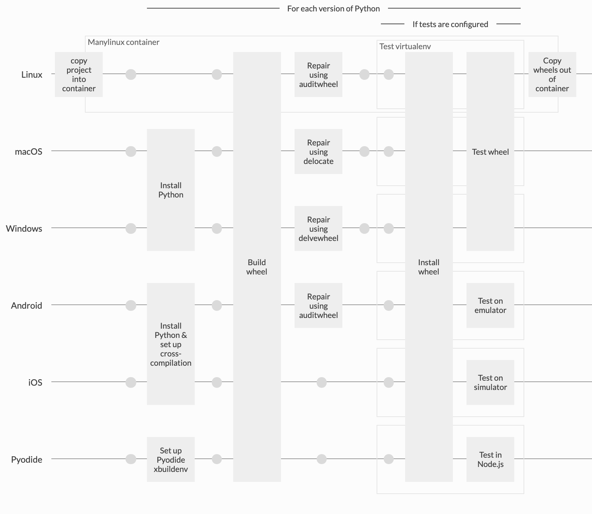

cibuildwheel
============

[](https://pypi.python.org/pypi/cibuildwheel)
[](https://cibuildwheel.pypa.io/en/stable/?badge=stable)
[](https://github.com/pypa/cibuildwheel/actions)
[](https://circleci.com/gh/pypa/cibuildwheel)
[](https://dev.azure.com/joerick0429/cibuildwheel/_build/latest?definitionId=4&branchName=main)


[Documentation](https://cibuildwheel.pypa.io)

<!--intro-start-->

Python wheels are great. Building them across **Mac, Linux, Windows**, on **multiple versions of Python**, is not.

`cibuildwheel` is here to help. `cibuildwheel` runs on your CI server - currently it supports GitHub Actions, Azure Pipelines, CircleCI, and GitLab CI - and it builds and tests your wheels across all of your platforms.


What does it do?
----------------

While cibuildwheel itself requires a recent Python version to run (we support the last three releases), it can target the following versions to build wheels:

|                    | macOS Intel | macOS Apple Silicon | Windows 64bit | Windows 32bit | Windows Arm64  | manylinux<br/>musllinux x86_64 | manylinux<br/>musllinux i686 | manylinux<br/>musllinux aarch64 | manylinux<br/>musllinux ppc64le | manylinux<br/>musllinux s390x | manylinux<br/>musllinux armv7l | Android | iOS | Pyodide        |
|--------------------| ----------- | ------------------- | ------------- | ------------- | -------------- | ------------------------------ | ---------------------------- | ------------------------------- | ------------------------------- | ----------------------------- | ------------------------------ | ------- | --- | -------------- |
| CPython 3.9        | ✅          | ✅                  | ✅            | ✅            | ✅<sup>2</sup> | ✅                             | ✅                           | ✅                              | ✅                              | ✅                            | ✅<sup>4</sup>                 | N/A     | N/A | N/A            |
| CPython 3.10       | ✅          | ✅                  | ✅            | ✅            | ✅<sup>2</sup> | ✅                             | ✅                           | ✅                              | ✅                              | ✅                            | ✅<sup>4</sup>                 | N/A     | N/A | N/A            |
| CPython 3.11       | ✅          | ✅                  | ✅            | ✅            | ✅<sup>2</sup> | ✅                             | ✅                           | ✅                              | ✅                              | ✅                            | ✅<sup>4</sup>                 | N/A     | N/A | N/A            |
| CPython 3.12       | ✅          | ✅                  | ✅            | ✅            | ✅<sup>2</sup> | ✅                             | ✅                           | ✅                              | ✅                              | ✅                            | ✅<sup>4</sup>                 | N/A     | N/A | ✅<sup>3</sup> |
| CPython 3.13       | ✅          | ✅                  | ✅            | ✅            | ✅<sup>2</sup> | ✅                             | ✅                           | ✅                              | ✅                              | ✅                            | ✅<sup>4</sup>                 | ✅      | ✅  | ✅             |
| CPython 3.14       | ✅          | ✅                  | ✅            | ✅            | ✅<sup>2</sup> | ✅                             | ✅                           | ✅                              | ✅                              | ✅                            | ✅<sup>4</sup>                 | ✅      | ✅  | ✅             |
| CPython 3.15       | ✅          | ✅                  | ✅            | ✅            | ✅<sup>2</sup> | ✅                             | ✅                           | ✅                              | ✅                              | ✅                            | ✅<sup>4</sup>                 | ✅      | ✅  | ✅             |
| PyPy 3.9 v7.3      | ✅          | ✅                  | ✅            | N/A           | N/A            | ✅<sup>1</sup>                 | ✅<sup>1</sup>               | ✅<sup>1</sup>                  | N/A                             | N/A                           | N/A                            | N/A     | N/A | N/A            |
| PyPy 3.10 v7.3     | ✅          | ✅                  | ✅            | N/A           | N/A            | ✅<sup>1</sup>                 | ✅<sup>1</sup>               | ✅<sup>1</sup>                  | N/A                             | N/A                           | N/A                            | N/A     | N/A | N/A            |
| PyPy 3.11 v8.0     | ✅          | ✅                  | ✅            | N/A           | N/A            | ✅<sup>1</sup>                 | ✅<sup>1</sup>               | ✅<sup>1</sup>                  | N/A                             | N/A                           | N/A                            | N/A     | N/A | N/A            |
| PyPy 3.12 v8.0     | ✅          | ✅                  | ✅            | N/A           | N/A            | ✅<sup>1</sup>                 | ✅<sup>1</sup>               | ✅<sup>1</sup>                  | N/A                             | N/A                           | N/A                            | N/A     | N/A | N/A            |
| GraalPy 3.12 v25.0 | ✅          | ✅                  | ✅            | N/A           | N/A            | ✅<sup>1</sup>                 | N/A                          | ✅<sup>1</sup>                  | N/A                             | N/A                           | N/A                            | N/A     | N/A | N/A            |
| GraalPy 3.13 v25.3 | N/A         | ✅                  | ✅            | N/A           | N/A            | ✅<sup>1</sup>                 | N/A                          | ✅<sup>1</sup>                  | N/A                             | N/A                           | N/A                            | N/A     | N/A | N/A            |

<sup>**1** PyPy & GraalPy are only supported for manylinux wheels.</sup><br>
<sup>**2** Windows arm64 support is experimental.</sup><br>
<sup>**3** Not supported on PyPI, uses old `pyodide` tag instead of `pyemscripten`. Requires `pyodide-eol` [`enable`](https://cibuildwheel.pypa.io/en/stable/options/#enable).</sup><br>
<sup>**4** manylinux armv7l support is experimental. As there are no RHEL based image for this architecture, it's using an Ubuntu based image instead.</sup><br>

- Builds manylinux, musllinux, macOS, Windows, pyemscripten, iOS, and Android wheels
- Supports CPython, PyPy, and GraalPy
- Works on GitHub Actions, Azure Pipelines, CircleCI, and GitLab CI
- Bundles shared library dependencies on Linux through [auditwheel](https://github.com/pypa/auditwheel), macOS through [delocate](https://github.com/matthew-brett/delocate), and Windows through [delvewheel](https://github.com/adang1345/delvewheel)
- Runs your library's tests against the wheel-installed version of your library

See the [cibuildwheel 1 documentation](https://cibuildwheel.pypa.io/en/1.x/) if you need to build unsupported versions of Python, such as Python 2.

Usage
-----

`cibuildwheel` runs inside a CI service. Supported platforms depend on which service you're using:

|                 | Linux | macOS | Windows | Linux ARM      | macOS ARM | Windows ARM    | Android                    | iOS                        | Pyodide        |
| --------------- | ----- | ----- | ------- | -------------- | --------- | -------------- | -------------------------- | -------------------------- | -------------- |
| GitHub Actions  | ✅    | ✅    | ✅      | ✅             | ✅        | ✅<sup>2</sup> | ✅<sup>4</sup>             | ✅<sup>3</sup>             | ✅             |
| Azure Pipelines | ✅    | ✅    | ✅      |                | ✅        | ✅<sup>2</sup> | ✅<sup>4</sup>             | ✅<sup>3</sup>             | ✅<sup>5</sup> |
| CircleCI        | ✅    | ✅    |         | ✅             | ✅        |                | ✅<sup>4</sup><sup>5</sup> | ✅<sup>3</sup><sup>5</sup> | ✅<sup>5</sup> |
| GitLab CI       | ✅    | ✅    | ✅      | ✅<sup>1</sup> | ✅        |                | ✅<sup>4</sup><sup>5</sup> | ✅<sup>3</sup><sup>5</sup> | ✅<sup>5</sup> |

<sup>**1** [Requires emulation](https://cibuildwheel.pypa.io/en/stable/faq/#emulation), distributed separately. Other services may also support Linux ARM through emulation or third-party build hosts, but these are not tested in our CI.</sup><br>
<sup>**2** [Uses cross-compilation](https://cibuildwheel.pypa.io/en/stable/faq/#windows-arm64). It is not possible to test `arm64` on this CI platform.</sup><br>
<sup>**3** Requires a macOS runner; runs tests on the simulator for the runner's architecture. </sup><br>
<sup>**4** Building for Android requires the runner to be Linux x86_64, macOS ARM64 or macOS x86_64. Testing has [additional requirements](https://cibuildwheel.pypa.io/en/stable/platforms/#android).</sup><br>
<sup>**5** Builds may work, but are untested in cibuildwheel's CI.</sup><br>

<!--intro-end-->

Example setup
-------------

To build manylinux, musllinux, macOS, and Windows wheels on GitHub Actions, you could use this `.github/workflows/wheels.yml`:

<!--generic-github-start-->
```yaml
name: Build

on: [push, pull_request]

jobs:
  build_wheels:
    name: Build wheels on ${{ matrix.os }}
    runs-on: ${{ matrix.os }}
    strategy:
      matrix:
        os: [ubuntu-latest, ubuntu-24.04-arm, windows-latest, windows-11-arm, macos-15-intel, macos-latest]

    steps:
      - uses: actions/checkout@v6
        with:
          persist-credentials: false

      # Used to host cibuildwheel
      - uses: actions/setup-python@v6

      - name: Install cibuildwheel
        run: python -m pip install cibuildwheel==4.3.5

      - name: Build wheels
        run: python -m cibuildwheel --output-dir wheelhouse
        # to supply options, put them in 'env', like:
        # env:
        #   CIBW_SOME_OPTION: value
        #   ...

      - uses: actions/upload-artifact@v6
        with:
          name: cibw-wheels-${{ matrix.os }}-${{ strategy.job-index }}
          path: ./wheelhouse/*.whl
```
<!--generic-github-end-->

For more information, including PyPI deployment, and the use of other CI services or the dedicated GitHub Action, check out the [documentation](https://cibuildwheel.pypa.io) and the [examples](https://github.com/pypa/cibuildwheel/tree/main/examples).

How it works
------------

The following diagram summarises the steps that cibuildwheel takes on each platform.



<sup>Explore an interactive version of this diagram [in the docs](https://cibuildwheel.pypa.io/en/stable/#how-it-works).</sup>

> [!WARNING]
> Building and testing wheels executes arbitrary code from your project and its dependencies. Although cibuildwheel uses OCI containers and Pyodide for some builds, these provide no security guarantees - the code you're building and testing has full access to the environment that's invoking cibuildwheel.
>
> If you cannot trust all the code that's pulled in, maintain good security hygiene: keep the job that builds distributions separate from the job that uploads them to PyPI, handle secrets and credentials with care and rotate them regularly, and follow the principle of least privilege when granting permissions. Do not store sensitive data on CI runners.


<!--[[[cog from readme_options_table import get_table; print(get_table()) ]]]-->

<!-- This table is auto-generated from docs/options.md by bin/readme_options_table.py -->

|   | Option | Description |
|---|---|---|
| **Build selection** | [`platform`](https://cibuildwheel.pypa.io/en/stable/options/#platform) | Override the auto-detected target platform |
|  | [`build`<br>`skip`](https://cibuildwheel.pypa.io/en/stable/options/#build-skip) | Choose the Python versions to build |
|  | [`archs`](https://cibuildwheel.pypa.io/en/stable/options/#archs) | Change the architectures built on your machine by default. |
|  | [`project-requires-python`](https://cibuildwheel.pypa.io/en/stable/options/#requires-python) | Manually set the Python compatibility of your project |
|  | [`enable`](https://cibuildwheel.pypa.io/en/stable/options/#enable) | Enable building with extra categories of selectors present. |
|  | [`allow-empty`](https://cibuildwheel.pypa.io/en/stable/options/#allow-empty) | Suppress the error code if no wheels match the specified build identifiers |
| **Build customization** | [`build-frontend`](https://cibuildwheel.pypa.io/en/stable/options/#build-frontend) | Set the tool to use to build, either "build" (default), "build\[uv\]", or "pip" |
|  | [`config-settings`](https://cibuildwheel.pypa.io/en/stable/options/#config-settings) | Specify config-settings for the build backend. |
|  | [`environment`](https://cibuildwheel.pypa.io/en/stable/options/#environment) | Set environment variables |
|  | [`environment-pass`](https://cibuildwheel.pypa.io/en/stable/options/#environment-pass) | Set environment variables on the host to pass-through to the container. |
|  | [`before-all`](https://cibuildwheel.pypa.io/en/stable/options/#before-all) | Execute a shell command on the build system before any wheels are built. |
|  | [`before-build`](https://cibuildwheel.pypa.io/en/stable/options/#before-build) | Execute a shell command preparing each wheel's build |
|  | [`xbuild-tools`](https://cibuildwheel.pypa.io/en/stable/options/#xbuild-tools) | Binaries on the path that should be included in an isolated cross-build environment. |
|  | [`xbuild-files`](https://cibuildwheel.pypa.io/en/stable/options/#xbuild-files) | Platform-specific files in the build environment |
|  | [`repair-wheel-command`](https://cibuildwheel.pypa.io/en/stable/options/#repair-wheel-command) | Execute a shell command to repair each built wheel |
|  | [`manylinux-*-image`<br>`musllinux-*-image`](https://cibuildwheel.pypa.io/en/stable/options/#linux-image) | Specify manylinux / musllinux container images |
|  | [`container-engine`](https://cibuildwheel.pypa.io/en/stable/options/#container-engine) | Specify the container engine to use when building Linux wheels |
|  | [`dependency-versions`](https://cibuildwheel.pypa.io/en/stable/options/#dependency-versions) | Control the versions of the tools cibuildwheel uses |
|  | [`pyodide-version`](https://cibuildwheel.pypa.io/en/stable/options/#pyodide-version) | Specify the Pyodide version to use for `pyodide` platform builds |
| **Auditing** | [`audit-requires`](https://cibuildwheel.pypa.io/en/stable/options/#audit-requires) | Install Python dependencies for the audit step |
|  | [`audit-command`](https://cibuildwheel.pypa.io/en/stable/options/#audit-command) | Use a tool to check wheels before the end of the run |
| **Testing** | [`test-command`](https://cibuildwheel.pypa.io/en/stable/options/#test-command) | The command to test each built wheel |
|  | [`before-test`](https://cibuildwheel.pypa.io/en/stable/options/#before-test) | Execute a shell command before testing each wheel |
|  | [`test-sources`](https://cibuildwheel.pypa.io/en/stable/options/#test-sources) | Paths that are copied into the working directory of the tests |
|  | [`test-requires`](https://cibuildwheel.pypa.io/en/stable/options/#test-requires) | Install Python dependencies before running the tests |
|  | [`test-extras`](https://cibuildwheel.pypa.io/en/stable/options/#test-extras) | Install your wheel for testing using `extras_require` |
|  | [`test-groups`](https://cibuildwheel.pypa.io/en/stable/options/#test-groups) | Specify test dependencies from your project's `dependency-groups` |
|  | [`test-skip`](https://cibuildwheel.pypa.io/en/stable/options/#test-skip) | Skip running tests on some builds |
|  | [`test-environment`](https://cibuildwheel.pypa.io/en/stable/options/#test-environment) | Set environment variables for the test environment |
|  | [`test-runtime`](https://cibuildwheel.pypa.io/en/stable/options/#test-runtime) | Controls how the tests will be executed. |
| **Debugging** | [`build-verbosity`](https://cibuildwheel.pypa.io/en/stable/options/#build-verbosity) | Increase/decrease the output of the build |
|  | [`debug-keep-container`](https://cibuildwheel.pypa.io/en/stable/options/#debug-keep-container) | Keep the container after running for debugging. |
|  | [`debug-traceback`](https://cibuildwheel.pypa.io/en/stable/options/#debug-traceback) | Print full traceback when errors occur. |
|  | [`log-fold-mode`](https://cibuildwheel.pypa.io/en/stable/options/#log-fold-mode) | Control CI log folding. |


<!--[[[end]]] (sum: iao/k2ZuR1) -->

These options can be specified in a pyproject.toml file, or as environment variables, see [configuration docs](https://cibuildwheel.pypa.io/en/latest/configuration/).

Working examples
----------------

Here are some repos that use cibuildwheel.

<!-- START bin/projects.py -->

<!-- this section is generated by bin/projects.py. Don't edit it directly, instead, edit docs/data/projects.yml -->

| Name                              | CI | OS | Notes |
|-----------------------------------|----|----|:------|
| [scikit-learn][]                  | ![github icon][] | ![windows icon][] ![apple icon][] ![linux icon][] ![pyodide icon][] | The machine learning library. A complex but clean config using many of cibuildwheel's features to build a large project with Cython and C++ extensions.  |
| [duckdb][]                        | ![github icon][] | ![apple icon][] ![linux icon][] ![windows icon][] | DuckDB is a high-performance analytical database system |
| [NumPy][]                         | ![github icon][] ![travisci icon][] | ![windows icon][] ![apple icon][] ![linux icon][] ![pyodide icon][] | The fundamental package for scientific computing with Python. |
| [pytorch-fairseq][]               | ![github icon][] | ![apple icon][] ![linux icon][] | Facebook AI Research Sequence-to-Sequence Toolkit written in Python. |
| [NCNN][]                          | ![github icon][] | ![windows icon][] ![apple icon][] ![linux icon][] | ncnn is a high-performance neural network inference framework optimized for the mobile platform |
| [Matplotlib][]                    | ![github icon][] | ![windows icon][] ![apple icon][] ![linux icon][] ![pyodide icon][] | The venerable Matplotlib, a Python library with C++ portions |
| [Tornado][]                       | ![github icon][] | ![linux icon][] ![apple icon][] ![windows icon][] | Tornado is a Python web framework and asynchronous networking library. Uses stable ABI for a small C extension. |
| [MyPy][]                          | ![github icon][] | ![apple icon][] ![linux icon][] ![windows icon][] | The compiled version of MyPy using MyPyC. |
| [Prophet][]                       | ![github icon][] | ![windows icon][] ![apple icon][] ![linux icon][] | Tool for producing high quality forecasts for time series data that has multiple seasonality with linear or non-linear growth. |
| [Triton][]                        | ![github icon][] | ![linux icon][] | Self hosted runners |

[scikit-learn]: https://github.com/scikit-learn/scikit-learn
[duckdb]: https://github.com/duckdb/duckdb
[NumPy]: https://github.com/numpy/numpy
[pytorch-fairseq]: https://github.com/facebookresearch/fairseq
[NCNN]: https://github.com/Tencent/ncnn
[Matplotlib]: https://github.com/matplotlib/matplotlib
[Tornado]: https://github.com/tornadoweb/tornado
[MyPy]: https://github.com/mypyc/mypy_mypyc-wheels
[Prophet]: https://github.com/facebook/prophet
[Triton]: https://github.com/openai/triton

[github icon]: docs/data/readme_icons/github.svg
[azurepipelines icon]: docs/data/readme_icons/azurepipelines.svg
[circleci icon]: docs/data/readme_icons/circleci.svg
[gitlab icon]: docs/data/readme_icons/gitlab.svg
[travisci icon]: docs/data/readme_icons/travisci.svg
[windows icon]: docs/data/readme_icons/windows.svg
[apple icon]: docs/data/readme_icons/apple.svg
[linux icon]: docs/data/readme_icons/linux.svg
[android icon]: docs/data/readme_icons/android.svg
[ios icon]: docs/data/readme_icons/ios.svg
[pyodide icon]: docs/data/readme_icons/pyodide.svg

<!-- END bin/projects.py -->

> ℹ️ That's just a handful, there are many more! Check out the [Working Examples](https://cibuildwheel.pypa.io/en/stable/working-examples) page in the docs.

Legal note
----------

Since `cibuildwheel` repairs the wheel with `delocate`, `auditwheel`, or `delvewheel`, it might automatically bundle dynamically linked libraries from the build machine.

It helps ensure that the library can run without any dependencies outside of the pip toolchain.

This is similar to static linking, so it might have some license implications. Check the license for any code you're pulling in to make sure that's allowed.

Changelog
=========

<!-- [[[cog from readme_changelog import mini_changelog; print(mini_changelog()) ]]] -->

### v4.3.5

_27 October 2026_

- 🐛 Stops passing the target build environment to the host virtualenv call, regression in v4.3.4 (#3023)
- 🛠 Updates dependencies and constraints (pyodide-build 0.39.3, CPython 3.15.2, etc) (#3024, #3027)
- 💼 Updates CI actions (#3025)

### v4.3.4

_22 October 2026_

- 🔐 Warns when a uv build frontend is selected and the host uv is older than 0.13.4, which still trusts the compromised eMudhra CA roots (#3021)
- 🔐 Uses cibuildwheel's CA bundle for pip on Python 3.9, where pip uses its bundled certifi, which still trusts the compromised eMudhra roots (#3017)
- 🔐 Uses cibuildwheel's CA bundle for pip on GraalPy, where truststore is not supported (#3019)
- 🔐 Uses cibuildwheel's CA bundle in Android, iOS, and Pyodide cross venvs, where pip uses the host's OpenSSL CA file (#3020)
- 🐛 Seeds build's isolated environment with the pinned pip on macOS and Windows, fixing GraalPy 25.0 builds (#3018)
- 💼 Stops Azure cache growth from `restoreKeys` (#3022)

### v4.3.3

_21 October 2026_

- 🔐 Updates manylinux images and pip to fix vulnerability to [eMudhra](https://emudhra.we-have-a-problem.com/).

### v4.3.2

_20 October 2026_

- 🔐 Updates our dependency pins to certifi==2026.10.19, following the [eMudhra Intermediate CA Compromise](https://emudhra.we-have-a-problem.com/). Linux builds may still be vulnerable through manylinux images - a patch release will soon follow if so.

### v4.3.1

_10 October 2026_

- 🛠 Updates CPython 3.15 to the final 3.15.0 release (#3009)

<!-- [[[end]]] (sum: Vhdgn7F0Yw) -->

---

That's the last few versions.

ℹ️ **Want more changelog? Head over to [the changelog page in the docs](https://cibuildwheel.pypa.io/en/stable/changelog/).**

---

Contributing
============

For more info on how to contribute to cibuildwheel, see the [docs](https://cibuildwheel.pypa.io/en/latest/contributing/).

Everyone interacting with the cibuildwheel project via codebase, issue tracker, chat rooms, or otherwise is expected to follow the [PSF Code of Conduct](https://github.com/pypa/.github/blob/main/CODE_OF_CONDUCT.md).

Maintainers
-----------

Core:

- Joe Rickerby [@joerick](https://github.com/joerick)
- Yannick Jadoul [@YannickJadoul](https://github.com/YannickJadoul)
- Matthieu Darbois [@mayeut](https://github.com/mayeut)
- Henry Schreiner [@henryiii](https://github.com/henryiii)
- Grzegorz Bokota [@Czaki](https://github.com/Czaki)
- Agriya Khetarpal [@agriyakhetarpal](https://github.com/agriyakhetarpal) (also Pyodide)

Platform maintainers:

- Russell Keith-Magee [@freakboy3742](https://github.com/freakboy3742) (iOS)
- Hood Chatham [@hoodmane](https://github.com/hoodmane) (Pyodide)
- Gyeongjae Choi [@ryanking13](https://github.com/ryanking13) (Pyodide)
- Tim Felgentreff [@timfel](https://github.com/timfel) (GraalPy)
- Malcolm Smith [@mhsmith](https://github.com/mhsmith) (Android)

Credits
-------

`cibuildwheel` stands on the shoulders of giants.

- ⭐️ @matthew-brett for [multibuild](https://github.com/multi-build/multibuild) and [matthew-brett/delocate](http://github.com/matthew-brett/delocate)
- @PyPA for the manylinux Docker images [pypa/manylinux](https://github.com/pypa/manylinux)
- @ogrisel for [wheelhouse-uploader](https://github.com/ogrisel/wheelhouse-uploader) and `run_with_env.cmd`

Massive props also to-

- @zfrenchee for [help debugging many issues](https://github.com/pypa/cibuildwheel/issues/2)
- @lelit for some great bug reports and [contributions](https://github.com/pypa/cibuildwheel/pull/73)
- @mayeut for a [phenomenal PR](https://github.com/pypa/cibuildwheel/pull/71) patching Python itself for better compatibility!
- @czaki for being a super-contributor over many PRs and helping out with countless issues!
- @mattip for his help with adding PyPy support to cibuildwheel

See also
========

Another very similar tool to consider is [matthew-brett/multibuild](http://github.com/matthew-brett/multibuild). `multibuild` is a shell script toolbox for building a wheel on various platforms. It is used as a basis to build some of the big data science tools, like SciPy.

If you are building Rust wheels, you can get by without some of the tricks required to make GLIBC work via manylinux; this is especially relevant for cross-compiling, which is easy with Rust. See [maturin-action](https://github.com/PyO3/maturin-action) for a tool that is optimized for building Rust wheels and cross-compiling.
